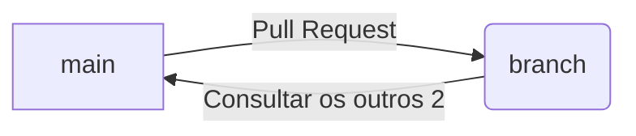

# TP1: Visualização de Árvores Arteriais (CCO)

Trabalho Prático 1 da disciplina de Computação Gráfica (BCC327). O objetivo deste projeto é a implementação modular de um pipeline gráfico para visualização e manipulação de modelos de árvores vasculares (formatos `.vtk`), com foco na representação geométrica manual, mapeamento de atributos, transformações e controlo de câmara.

---

## Equipe

| Nome | Matrícula |
| --- | --- |
| Cauã Lemos Câmara | 24.1.4035 |
| César Augusto Tiago Totô | 24.1.4038 |
| Roberto Antonino Menegassi Filho | 24.1.4002 |

---

## Tecnologia Gráfica Utilizada
* **Linguagem:** Python
* **Biblioteca de Visualização/Renderização 3D:** PyVista (Arquivo **VTK** ), responsável pela janela, câmera, projeções, interação por mouse e widgets.
* **Computação Numérica:** NumPy (para manipulação numérica).
* **Manipulação de Cores:** Matplotlib (para visuzlização, mapa de cores, geração de figuras...).

---

## Dependências
 
| Biblioteca | Versão testada | Uso |
| --- | --- | --- |
| Python | **3.10.12** | Linguagem |
| pyvista | **0.49.1.** | Leitura VTK, tubos, câmera, widgets, antialiasing |
| vtk | **9.7.1** | Instalada como dependência do PyVista |
| numpy | **1.24.4** | Cálculo numérico |
| matplotlib | **3.10.3** | Colormap e figuras |


---

## Instalação (compilação)
 
Basta instalar as dependências:
 
```bash
pip install pyvista numpy matplotlib
```

---

## Execução
 
Os comandos devem ser executados **a partir da pasta `src/`**, pois os caminhos dos dados são relativos a ela.
 
### Execução completa
 
```bash
cd src
python3 main.py                                              # usa o modelo padrão
python3 main.py ../data/dados_modelos3D/tree3D_Nterm016.vtk  # modelo informado
```

### Execução indivídual (recomendado)
 
```bash
cd src
python3 modulos/modulo1.py ../data/dados_modelos2D/tree2D_Nterm032.vtk
python3 modulos/modulo3.py ../data/dados_modelos2D/tree2D_Nterm032.vtk   # Gera uma imagem na pasta report/figures
python3 modulos/modulo4.py ../data/dados_modelos2D/tree2D_Nterm032.vtk
python3 modulos/modulo6.py ../data/dados_modelos2D/tree2D_Nterm032.vtk


# Módulo 7 não usa arquivo .vtk (polígono de teste embutido no código)
python3 modulos/modulo7.py

# Módulo 2 e 5 são mostrados ao executar na main.


```
 
O modelo padrão, definido em `main.py` (`PATH_FILE`), é `../data/dados_modelos3D/tree3D_Nterm016.vtk`.

> Ao rodar um módulo isolado, passe sempre o caminho do `.vtk` como argumento. O caminho padrão embutido nos módulos usa `../../data/`, que só funciona se o comando for executado de dentro de `src/modulos/`.

---

## Localização Esperada dos Arquivos VTK
 
Os arquivos fornecidos pelo professor (`dados_modelos2D.zip` e `dados_modelos3D.zip`) foram extraídos em `data/`, na raiz do projeto:
 
```text
data/
├── dados_modelos2D/     # ex.: tree2D_Nterm008.vtk...
└── dados_modelos3D/     # ex.: tree3D_Nterm016.vtk...
```
 
Cada arquivo é um `PolyData` com pontos, conectividade dos segmentos (linhas) e o atributo de **raio** por célula.

---

## Comandos de Mouse, Teclado e Widgets
 
### Mouse e teclado (padrão do PyVista)
 
| Ação | Efeito |
| --- | --- |
| Botão esquerdo + arrastar | Rotaciona a cena |
| Roda do mouse / botão direito + arrastar | Zoom |
| Botão do meio (ou Shift + esquerdo) + arrastar | Pan (translação da câmera) |
| `r` | Reseta o zoom |
| `v` | Vista isométrica |
| `w` / `s` | Alterna entre wireframe e superfície |
| `q` | Fecha a janela |

### Widgets da interface
 
As posições abaixo foram definidas em pixels para a janela de 1920×1080 aberta pelo `main.py`.
 
| Módulo | Widget | Função |
| --- | --- | --- |
| 1 | Checkbox "Cor em função do raio" | Liga/desliga o mapa de cores por raio (azul = fino, vermelho = grosso) |
| 1 | Checkbox "Espessura em função do raio" | Liga/desliga a espessura do tubo proporcional ao raio |
| 2 | Radio "Projeção ortogonal" / "Projeção Paralela" | Alterna o tipo de projeção da câmera |
| 2 | Radio "Vista Frontal" / "Lateral" / "Superior" | Posiciona a câmera nos planos `yz`, `xz` e `xy` |
| 4 | Checkbox "Árvore rasterizada (Scanline)" | Mostra/esconde a imagem rasterizada ao lado da árvore |
| 5 | Radio "Sem Antialiasing" / "MSAA" / "FXAA" / "SSAA" | Seleciona a técnica de antialiasing |
| 6 | Checkbox "Usar Liang-Barsky" | Recorta com Liang–Barsky |
| 6 | Checkbox "Usar Cohen-Sutherland" | Recorta com Cohen–Sutherland (ligado por padrão) |
| 6 | Slider "Tamanho da janela de recorte" | Altera o tamanho da janela (10% a 120% da árvore) |
| 7 | Arrastar com o mouse (sem widget) | Move a janela de recorte (retângulo preto) sobre o polígono; o recorte é recalculado a cada movimento |
 
Em tela, o programa também mostra: nome do modelo, nº de pontos/segmentos e raio mín./máx. (Módulo 1); nº de polígonos e pixels pintados (Módulo 4); e estatísticas do recorte (Módulo 6). No Módulo 7, o polígono original aparece em **cinza**, a janela em **preto** e a saída do Sutherland–Hodgman em **vermelho**.

---
 
## Roteiro Mínimo de Teste
 
1. **Módulo 1:** execute `python3 main.py`. No terminal, confira o número de pontos, segmentos e o raio mínimo/máximo. Na janela, desligue e ligue os dois checkboxes (cor e espessura) e observe as quatro combinações.
2. **Módulo 2:** clique nas três vistas (frontal, lateral, superior) e alterne a projeção. Gire e dê zoom com o mouse e compare perspectiva × paralela.
3. **Módulo 3:** execute o comando do Módulo 3 da seção *Execução* e confira o arquivo `rasterizacao_linhas.png`, gerado na pasta report/figures. Ele mostra, para 20 segmentos da árvore, os pixels do Bresenham (quadrados), os pixels do DDA (círculos) e a reta ideal (tracejada).
4. **Módulo 4:** observe a imagem rasterizada ao lado da árvore e o contador de pixels pintados. Use o checkbox para escondê-la. A figura é salva em `report/figures/modulo4_arvore_scanline.png`.
5. **Módulo 5:** alterne entre "Sem Antialiasing", MSAA, FXAA e SSAA e compare o serrilhado nas bordas dos tubos (use zoom).
6. **Módulo 6:** aproxime-se do modelo 2D (`tree2D_*.vtk`) para ver melhor. Veja a janela laranja, os trechos mantidos (verde) e descartados (vermelho). Alterne entre Cohen–Sutherland e Liang–Barsky, mude o tamanho da janela pelo slider e compare os contadores de interseções e divisões.
7. **Módulo 7:** execute `python3 modulos/modulo7.py`. Arraste a janela preta com o botão esquerdo: parcialmente sobre o polígono, a saída vermelha acompanha a região recortada; com a janela contendo todo o polígono, a saída coincide com ele; com a janela totalmente fora, nada é desenhado.

---

## Funcionalidades: Implementação do Grupo × Auxílio de Bibliotecas
 
### Implementado pelo grupo
 
| Módulo | O que foi implementado manualmente |
| --- | --- |
| 1 | Leitura e detecção do atributo de raio; decomposição das células em segmentos (pares de pontos); construção da malha de linhas; função de cor RGB (`R = t`, `G = 0,5`, `B = 1 − t`, com `t` o raio normalizado); escala de espessura proporcional ao raio |
| 3 | **DDA** e **Bresenham** (inteiro, todos os octantes); conversão dos pontos da árvore para coordenadas inteiras de pixel (`ceil(500·coord)`); rasterização dos 20 primeiros segmentos; figura comparativa dos dois algoritmos  |
| 4 | **Scanline Fill** completo (Edge Table, Active Edge Table, regra par-ímpar); construção do retângulo de cada vaso a partir de direção e normal; transformação mundo → pixel; rotação do modelo em torno do centro; buffer de pixels N×N×3 |
| 6 | **Cohen–Sutherland** (códigos de região, aceitação/rejeição, interseções); **Liang–Barsky** (parâmetros `p`, `q`, `t_entrada`, `t_saida`); interpolação de `z` para modelos 3D; contadores de interseções/divisões|
| 7 | **Sutherland–Hodgman** (teste de semiplano por borda, interseção por parametrização, passo por borda e encadeamento das 4 bordas na ordem baixo, direita, topo, esquerda, com histórico por etapa); polígono convexo de teste de 7 vértices; conversão tela → mundo e arraste da janela com eventos de mouse |
 
### Realizado com auxílio de bibliotecas
 
| Funcionalidade | Biblioteca / API |
| --- | --- |
| Leitura dos arquivos `.vtk` | `pyvista.read` |
| Geração dos tubos (cilindros de 8 lados) a partir das linhas | `PolyData.tube` (PyVista/VTK) |
| Renderização, iluminação, câmera, projeção perspectiva/paralela, interação por mouse | PyVista/VTK (`Plotter`) |
| Widgets (checkbox, radio, slider) | PyVista |
| Antialiasing (MSAA, FXAA, SSAA) | PyVista (`enable_anti_aliasing`) |
| Exibição da imagem do Scanline como malha de pixels | `pv.ImageData` |
| Colormap e salvamento das figuras | Matplotlib |
| Operações vetoriais e arrays | NumPy |

---

## Estrutura de Diretórios

```text
BCC327-TP1/
│
├── data/							# Ficheiros de dados .vtk (2D e 3D)
    	├── dados_modelos2D				
    	├── dados_modelos3D                  	
├── demo/
├── presentation/					# Pasta com os arquivos referente a apresentação.
	├── apresentacao.tex			# Arquivo com o código com a Apresentação (.tex)
	├── apresentacao.pdf			# Arquivo em PDF com a apresentação
	├── figures						# Figuras usadas na apresentação
├── report/							# Pasta com as imagens e o Relatório .tex e .pdf
	├── relatorio					# Pasta com os arquivos referentes ao relatório
		├── relatorio.tex			# Arquivo com o código com o relatório (.tex)
		├── relatorio.pdf			# Arquivo em PDF com o relatório.
		├── figures					# Pasta com as figuras do relatório.
	├── figures						# Pasta com as figuras geradas.              	
└── src/
    	├── main.py						
    	├── modulos            		# Pasta com os modulos implementados
    		├── modulo1.py        	# Implementação do Módulo 1
    		├── modulo2.py         	# Implementação do Módulo 2
    		├── ...                	# Demais módulos implementados
			└── modulo7.py			# Implementação do Módulo 7
```

## Fluxo de Trabalho (Git)




