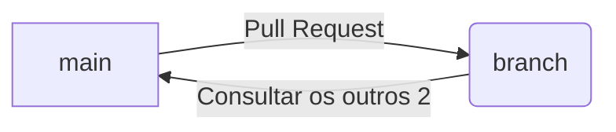

# TP1: Visualização de Árvores Arteriais (CCO)

Trabalho Prático 1 da disciplina de Computação Gráfica (BCC327). O objetivo deste projeto é a implementação modular de um pipeline gráfico para visualização e manipulação de modelos de árvores vasculares (formatos `.vtk`), com foco na representação geométrica manual, mapeamento de atributos, transformações e controlo de câmara.

---
## 👥 Estrutura do Grupo e Organização
O projeto foi desenvolvido com uma arquitetura modular, permitindo o trabalho em paralelo de todos os integrantes:

* **Módulo 1:** 
* **Módulo 2:** 
* **Módulos 3:**
* **Módulos 4:**
* **Módulos 5:**
* **Módulos 6:**
* **Módulos 7:**
* **`main.py`:** 

---

## 🛠️ Tecnologia Gráfica Utilizada
* **Linguagem:** Python
* **Biblioteca de Visualização/Renderização 3D:** PyVista (Arquivo **VTK** ).
* **Computação Numérica:** NumPy (para manipulação numérica).
* **Manipulação de Cores:** Matplotlib (para visuzlização, cores...).

---

## Compilação

---

## Execução

---

## 📂 Estrutura de Diretórios

```text
BCC327-TP1/
│
├── data/							# Ficheiros de dados .vtk (2D e 3D)
    	├── dados_modelos2D				
    	├── dados_modelos3D                  	
├── demo/
├── presentation/
	├── apresentacao.tex			#Arquivo com o código com a Apresentação (.tex)
	├── apresentacao.pdf			#Arquivo em PDF com a apresentação
	├── figures						#Figuras usadas na apresentação
├── report/							#Pasta com as imagens e o Relatório .tex e .pdf
	├── relatorio.tex
	├── relatorio.pdf
	├── figures						#Pasta com as figuras geradas e figuras do relatório              	
└── src/
    	├── main.py						
    	├── modulos            		#Pasta com os modulos implementados
    		├── modulo1.py        	# Implementação do Módulo 1
    		├── modulo2.py         	# Implementação do Módulo 2
    		├── ...                	# Demais módulos do implementados
			└── modulo7.py			# Implementação do Módulo 7
```

## 👨‍💻 Equipe

| Nome | Matrícula |
| --- | --- |
| Cauã Lemos Câmara | xx.x.xxxx |
| César Augusto Tiago Totô | 24.1.4038 |
| Roberto Antonino Menegassi Filho | xx.x.xxxx |





